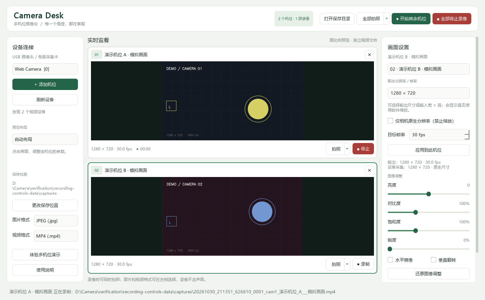

# Camera Desk 多机位摄像台

适用于 Windows 10 / 11 的 64 位便携摄像工具。可连接两个或更多标准 USB/UVC 免驱摄像头，以及被 Windows 识别为摄像头的 USB 视频采集卡。

应用代码采用 [MIT 许可证](LICENSE)。项目结构包含完整源码、自动化测试、Windows 打包脚本及 GitHub Actions 发行流程。当前功能与验证范围见 [更新记录](CHANGELOG.md) 和 [验证记录](docs/VALIDATION.md)。



## 在其他电脑上使用

**单文件版：** 将 `CameraDesk-Standalone-Windows-x64.exe` 复制到 Windows 10/11 x64 电脑的可写文件夹，直接双击运行。Python、Qt 和编码组件均已整合，无需安装开发环境。首次启动会先将运行组件解包到系统临时目录，可能比便携文件夹版稍慢。

**便携文件夹版：**

1. 将 `CameraDesk-Windows-x64.zip` 复制到目标电脑。
2. 解压整个压缩包到可写文件夹，例如桌面或文档文件夹。
3. 进入 `CameraDesk` 文件夹，双击 `CameraDesk.exe`。无需安装 Python。
4. 接入摄像头，在软件中刷新设备并添加机位。点击某个画面后，可调整对应机位的参数。

**便携文件夹版需保留整个 `CameraDesk` 文件夹，包括 `_internal`；单文件版 EXE 则可以单独复制运行。** 两种版本的数据目录规则相同。

首次运行时可能显示 Windows 的未知发布者提示；当前版本未进行代码签名。请通过自己保存的原始软件包核对来源。系统如果提示缺少 `VCRUNTIME140.dll` 等组件，可安装微软官方 [Visual C++ 2015–2022 x64 运行库](https://aka.ms/vs/17/release/vc_redist.x64.exe)。

## 功能

- 多个机位独立预览，可分别设置输出分辨率和目标帧率，显示设备采集尺寸及是否使用软件缩放。
- 实时调整亮度、对比度、饱和度、锐度，以及水平镜像和垂直翻转。
- 按机位拍照和录制，也可一键对所有已打开机位执行拍照或录制操作。
- 照片可选 PNG、JPEG、BMP、TIFF、WebP；视频可选 AVI、MP4、MKV，均不含音频。画面调整会同时作用于预览、照片和视频。
- 录像中可继续进行单机位或全部机位拍照，保存照片不会主动停止、分段或重启录像。
- 支持的摄像头可尝试曝光、自动曝光、自动对焦和白平衡等硬件控制，具体以设备响应为准。
- 提供多机位模拟演示，未接摄像头也能查看操作界面。

“全部开始录像”会依次向各机位发出启动指令，不能替代硬件同步或逐帧同步。软件不会采集麦克风声音。摄像头实际支持的采集尺寸、帧率及硬件参数由设备决定。

## 同时录像与独立录像

- 顶部“全部开始录像”：一次开始所有可用且尚未录像的机位。已有机位正在录像时，按钮显示“开始其余机位”，只启动剩余机位，原录像继续写入原文件。
- 每个画面上的“录制／停止”：各机位可按任意顺序独立开始和停止，互不影响，也可以与顶部的全部操作混用。
- 顶部“全部停止录像”：统一停止并保存各路录像，也会取消尚在开始中的录像；不再弹出命名窗口。

正在开始的机位可点击“取消开始”；正在结束保存的机位会显示“正在保存…”。某一路开始失败时，其他机位仍可继续录像。

录像期间，各画面的“拍照”与顶部“全部拍照”保持可用。点击后直接保存，不弹保存窗口；默认使用左侧预设目录及图片格式，文件名自动包含时间、序号和机位编号，原录像继续写入原文件。退出软件时会等待已接受的照片保存完成。

## 分别设置各机位的分辨率

1. 点击画面，或在右侧“画面设置”的下拉框选择对应摄像头。
2. 选择输出尺寸，或直接输入 `1280 × 960` 等自定义宽高；设置目标帧率。
3. 点击“应用到此机位”。切换其他机位后，尚未应用的选择会分别保留。

软件优先尝试原生采集尺寸。设备只返回固定尺寸时，会按所选输出宽高缩放，并标明“软件缩放”；预览、照片和视频采用相同输出尺寸。缩放不会增加相机的原始细节，也不会降低 USB 端的原始采集带宽。

如只接受真实原生采集，请勾选“仅相机原生分辨率（禁止缩放）”。设备不支持时会恢复此前画面并提示，不会把请求尺寸显示成已成功的原生尺寸。录制中的机位需先停止录制再切换分辨率，其他机位可继续运行。

## 文件保存

设置和默认输出保存在 EXE 同级的 `data` 文件夹内；界面可选择其他照片、视频保存位置。程序所在文件夹无法写入时，会改用当前用户的 `%LOCALAPPDATA%\CameraDesk`。软件在本地处理画面，无需上传或联网服务。

普通“拍照／全部拍照”使用快捷保存，不弹窗。需要手动选择目录或命名时，点击拍照按钮右侧箭头，选择“拍照并另存为…”或“全部拍照并另存为…”。开始录像仍可选择目录和文件名；全部开始录像统一选择目录、统一名称并可逐机位修改。取消另存为或录像保存窗口时不会开始新拍摄。停止录像直接保存，不再询问文件名。

多路同时拍摄默认共用侧边栏设置的保存文件夹，所有机位的照片或录像直接放在该文件夹内，以机位编号或自定义文件名区分。每批只需选择一次文件夹；后续批次和重启软件后继续使用最近选择的目录。

软件会记住最近使用的保存目录。同名文件会提示是否替换，只有确认后才允许覆盖；已有录像会保留到新录像成功保存并通过读取校验后再替换。批量文件名不能相同，也不能与正在录制的文件冲突。

左侧可选择默认图片／视频格式，单机位“另存为”和多机位保存窗口也可以选择格式；切换格式会更新文件后缀并保留自定义名称。选择会被记住，修改视频格式仅影响下一次开始的录像，正在录制的文件保持原格式。

图片支持 `.png`、`.jpg`/`.jpeg`、`.bmp`、`.tif`/`.tiff`、`.webp`；视频支持 `.avi`（MJPEG）、`.mp4`（MPEG-4）、`.mkv`（MJPEG）。这些文件使用对应编码器和容器实际保存，而不是只修改扩展名。

命令行可指定数据目录或启动演示：

```powershell
.\CameraDesk.exe --demo
.\CameraDesk.exe --demo --demo-count 8
.\CameraDesk.exe --data-dir "D:\CameraDeskData"
```

## 连接问题

- 没有设备：确认 Windows“设置 → 隐私和安全性 → 相机”允许桌面应用访问相机，重新插拔后刷新设备。
- 打开失败：先退出正在占用摄像头的会议、聊天或其他拍摄软件。
- 多机位卡顿或黑屏：先降低分辨率和帧率，分别接到不同 USB 接口；多个高分辨率摄像头共用集线器可能耗尽 USB 带宽或供电。
- 普通 HDMI 相机：需要适合的视频采集卡，不能用普通 USB 数据线替代视频采集。
- 工业相机或专有接口设备：本版面向标准 UVC 设备，厂商 SDK 控制需要另行适配。

日志位于数据目录的 `camera-desk.log`。本地已完成模拟多机位测试，并在一台 `Web Camera` 上验证 DirectShow 连接和 1280 × 720 单帧读取；多台真实设备同时工作及其他电脑的兼容性仍需实测。完整范围见 [验证记录](docs/VALIDATION.md)。

## 从源码运行或重建

源码包含在便携包的 `source` 目录，也提供独立的 `CameraDesk-Source.zip`。重建需要 Windows 64 位和 Python 3.8–3.11；推荐 Python 3.11，GitHub CI 也使用此版本。本地初版使用 Python 3.8.6 构建。

```powershell
py -3.11 -m venv .venv
.\.venv\Scripts\python.exe -m pip install -r requirements-dev.txt
.\.venv\Scripts\python.exe main.py --demo
$env:QT_QPA_PLATFORM = 'offscreen'
.\.venv\Scripts\python.exe -m pytest -q --basetemp test-output/pytest
powershell -ExecutionPolicy Bypass -File .\build.ps1
```

也可运行 `build.ps1 -InstallDependencies` 创建环境并安装依赖。构建生成 `dist\CameraDesk\CameraDesk.exe` 和项目根目录的 `CameraDesk-Windows-x64.zip`。若输出目录已包含用户 `data`，构建会拒绝覆盖；更新时使用新的暂存目录。

单文件版可用 `build.ps1 -SingleFile -NoZip -DistDirectory build\standalone-dist` 生成，项目根目录输出 `CameraDesk-Standalone-Windows-x64.exe`。运行组件和许可证内嵌在 EXE 中；源代码及第三方对应源码作为发行附件保留。兼容修改后的 Qt/PySide 库可通过随附源码重新构建单文件版；文件夹版也可直接替换 DLL。

## GitHub 开源与发行

把项目根目录上传为 GitHub 仓库即可。普通提交和 PR 会运行 Windows 测试；推送与当前版本号一致的 `v1.1.2` 等标签后，发行工作流会测试、构建两种可执行版本、打包应用及第三方源码、计算校验值，并创建草稿发行版供维护者检查。

完整步骤见 [发行指南](docs/RELEASING.md)，参与开发见 [CONTRIBUTING.md](CONTRIBUTING.md)。源码与便携包中不包含拍摄内容、个人设置或开发环境。

第三方组件及许可证见 [THIRD_PARTY.md](THIRD_PARTY.md) 和 `LICENSES` 文件夹。
